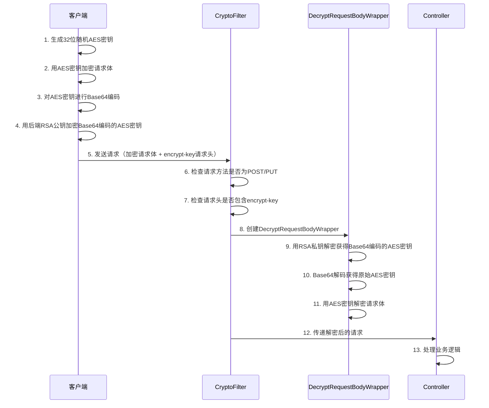
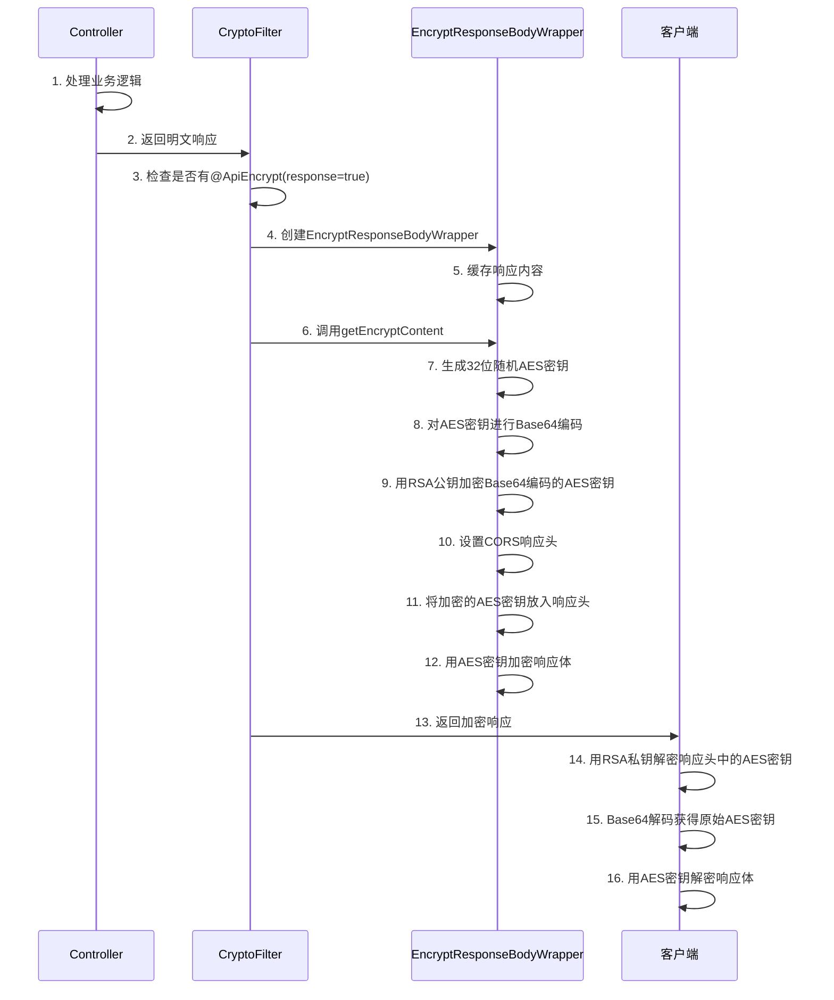

# API接口加密

## 介绍

API接口加密功能通过Servlet过滤器实现，支持前后端数据传输的全链路加密。系统采用"非对称加密传递对称密钥 + 对称加密报文"的混合加密方案，既保证了安全性又兼顾了性能，是企业级应用中保护敏感数据传输的核心安全组件。

混合加密支持两种算法组合，通过 `api-decrypt.algorithm` 一个开关切换：默认的 **RSA + AES**（与历史版本完全兼容），以及满足信创/密评要求的国密 **SM2 + SM4**。前后端必须配置为同一取值，系统不做运行时协商，避免请求方把算法降级为强度更低的组合。

**核心特性:**

- **混合加密** - 非对称算法加密对称密钥、对称算法加密报文，结合非对称加密的安全性和对称加密的高效性
- **国密可选** - 支持 RSA+AES（默认）与 SM2+SM4（国密）两种算法组合，后端与三端前端各改一个开关即可切换
- **策略化实现** - 算法细节封装在 `IApiCryptor` 策略接口中，过滤器与请求/响应包装器不再写死具体算法
- **启动即校验** - 所选算法的公私钥未配齐时应用启动直接失败，不会拖到第一个加密请求才报错
- **自动解密** - 请求体自动解密，无需业务代码干预
- **可选加密** - 响应加密通过注解按需开启，灵活控制
- **双密钥对** - 请求和响应使用独立的密钥对，提高安全性
- **高优先级** - 过滤器以最高优先级运行，确保在其他处理之前完成解密
- **CORS支持** - 自动设置跨域响应头，支持前端跨域请求

## 模块架构

### 整体架构

下图以默认的 RSA+AES 为例；切换为 SM2 时，图中的 RSA 对应 SM2、AES 对应 SM4，流程完全相同。

```text
┌─────────────────────────────────────────────────────────────┐
│                         客户端                               │
│  ┌─────────────────────────────────────────────────────────┐│
│  │  1. 生成AES密钥                                          ││
│  │  2. RSA公钥加密AES密钥                                   ││
│  │  3. AES密钥加密请求体                                    ││
│  └─────────────────────────────────────────────────────────┘│
└────────────────────────────┬────────────────────────────────┘
                             │ 加密的请求
                             ▼
┌─────────────────────────────────────────────────────────────┐
│                    CryptoFilter (最高优先级)                  │
│  ┌─────────────────────────────────────────────────────────┐│
│  │  DecryptRequestBodyWrapper                              ││
│  │  • RSA私钥解密请求头中的AES密钥                          ││
│  │  • AES密钥解密请求体                                     ││
│  └─────────────────────────────────────────────────────────┘│
└────────────────────────────┬────────────────────────────────┘
                             │ 明文请求
                             ▼
┌─────────────────────────────────────────────────────────────┐
│                    Controller (@ApiEncrypt)                  │
│  ┌─────────────────────────────────────────────────────────┐│
│  │  业务逻辑处理                                            ││
│  │  返回明文响应                                            ││
│  └─────────────────────────────────────────────────────────┘│
└────────────────────────────┬────────────────────────────────┘
                             │ 明文响应
                             ▼
┌─────────────────────────────────────────────────────────────┐
│                    CryptoFilter (响应处理)                   │
│  ┌─────────────────────────────────────────────────────────┐│
│  │  EncryptResponseBodyWrapper                             ││
│  │  • 生成新的AES密钥                                       ││
│  │  • AES密钥加密响应体                                     ││
│  │  • RSA公钥加密AES密钥放入响应头                          ││
│  └─────────────────────────────────────────────────────────┘│
└────────────────────────────┬────────────────────────────────┘
                             │ 加密的响应
                             ▼
┌─────────────────────────────────────────────────────────────┐
│                         客户端                               │
│  ┌─────────────────────────────────────────────────────────┐│
│  │  1. RSA私钥解密响应头中的AES密钥                         ││
│  │  2. AES密钥解密响应体                                    ││
│  └─────────────────────────────────────────────────────────┘│
└─────────────────────────────────────────────────────────────┘
```

### 核心类结构

```text
plus.ruoyi.common.encrypt
├── annotation/
│   └── ApiEncrypt.java                    # API加密注解
├── config/
│   └── ApiDecryptAutoConfiguration.java   # 自动配置类（按算法创建加解密器）
├── core/api/
│   ├── IApiCryptor.java                   # 接口加解密器策略接口
│   ├── RsaAesApiCryptor.java              # RSA + AES 实现（默认）
│   ├── Sm2Sm4ApiCryptor.java              # SM2 + SM4 国密实现
│   └── ApiCryptoKeys.java                 # 对称密钥生成（SecureRandom）
├── enumd/
│   └── ApiEncryptAlgorithm.java           # 算法组合枚举（RSA / SM2）
├── filter/
│   ├── CryptoFilter.java                  # 加解密过滤器
│   ├── DecryptRequestBodyWrapper.java     # 请求体解密包装器
│   └── EncryptResponseBodyWrapper.java    # 响应体加密包装器
├── properties/
│   └── ApiDecryptProperties.java          # 配置属性类
└── utils/
    └── EncryptUtils.java                  # 加解密工具类
```

## 配置说明

### 基础配置

在 `application.yml` 中配置API加密参数：

框架在 `ruoyi-admin/src/main/resources/application.yml` 中的默认配置如下（密钥已截断）：

```yaml
api-decrypt:
  # 是否开启全局接口加密
  enabled: ${API_ENCRYPT_ENABLED:true}
  # 加密头标识（存放加密后的对称密钥）
  headerFlag: encrypt-key
  # 加密算法 必须与前端 VITE_APP_API_ENCRYPT_ALGORITHM 一致
  # RSA: RSA+AES(默认)  SM2: SM2+SM4(国密，信创/密评项目使用)
  algorithm: ${API_ENCRYPT_ALGORITHM:RSA}
  # ----- algorithm=RSA 时使用的 RSA 密钥 -----
  # 响应加密公钥，对应前端解密私钥 VITE_APP_RSA_PRIVATE_KEY
  publicKey: ${API_RESPONSE_PUBLIC_KEY:MFwwDQYJKoZIhvcNAQEBBQADSwAwSAJBAIrZxEhz...}
  # 请求解密私钥，对应前端加密公钥 VITE_APP_RSA_PUBLIC_KEY
  privateKey: ${API_REQUEST_PRIVATE_KEY:MIIBOgIBAAJBAK9s1Pbnn5W+l1hx3ukHLtev...}
  # ----- algorithm=SM2 时使用的 SM2 密钥（Hex 原始格式，与前端 sm-crypto 一致）-----
  sm2:
    # 响应加密公钥(04 开头 130 位)，对应前端解密私钥 VITE_APP_SM2_PRIVATE_KEY
    publicKey: ${API_SM2_RESPONSE_PUBLIC_KEY:04c5f053276fc40c4207a9afc6926745...}
    # 请求解密私钥(64 位)，对应前端加密公钥 VITE_APP_SM2_PUBLIC_KEY
    privateKey: ${API_SM2_REQUEST_PRIVATE_KEY:ceefcceb535f94666532586ccf3a45f7...}
```

RSA 与 SM2 两套密钥分开配置，互不覆盖，切换算法时只需改 `algorithm` 一个开关。框架内置的默认 SM2 密钥已与三端前端的默认值配对，开发环境切到 SM2 无需改密钥即可跑通。

::: danger 生产必须更换密钥
上述 RSA / SM2 密钥均为框架默认值（RSA 仅 512 位），人人可见。生产环境必须用下文的密钥生成器重新生成，并且前后端两对密钥必须成对更换。
:::

### 配置项说明

| 配置项 | 类型 | 说明 | 默认值 |
|--------|------|------|--------|
| `enabled` | `Boolean` | 是否启用API加密功能，为 `true` 时才注册过滤器 | - |
| `header-flag` | `String` | 请求/响应头中存放加密对称密钥的字段名 | - |
| `algorithm` | `ApiEncryptAlgorithm` | 加密算法组合：`RSA`（RSA+AES）/ `SM2`（SM2+SM4），必须与前端一致 | `RSA` |
| `public-key` | `String` | RSA 公钥，`algorithm=RSA` 时加密响应中的 AES 密钥 | - |
| `private-key` | `String` | RSA 私钥，`algorithm=RSA` 时解密请求中的 AES 密钥 | - |
| `sm2.public-key` | `String` | SM2 公钥（Hex，`04+x+y` 共 130 位），`algorithm=SM2` 时加密响应中的 SM4 密钥 | - |
| `sm2.private-key` | `String` | SM2 私钥（Hex，64 位），`algorithm=SM2` 时解密请求中的 SM4 密钥 | - |

`algorithm` 未配置时按 `RSA` 处理，老项目升级后行为与原来完全一致。

### 环境变量

`application.yml` 中的配置项都预留了环境变量，Docker 部署时直接在 compose 的后端实例中设置即可：

| 环境变量 | 对应配置项 | 说明 |
|---------|-----------|------|
| `API_ENCRYPT_ENABLED` | `api-decrypt.enabled` | 全局接口加密开关 |
| `API_ENCRYPT_ALGORITHM` | `api-decrypt.algorithm` | 加密算法，`RSA` / `SM2` |
| `API_RESPONSE_PUBLIC_KEY` | `api-decrypt.public-key` | RSA 响应加密公钥 |
| `API_REQUEST_PRIVATE_KEY` | `api-decrypt.private-key` | RSA 请求解密私钥 |
| `API_SM2_RESPONSE_PUBLIC_KEY` | `api-decrypt.sm2.public-key` | SM2 响应加密公钥 |
| `API_SM2_REQUEST_PRIVATE_KEY` | `api-decrypt.sm2.private-key` | SM2 请求解密私钥 |

compose 文件中 `API_SM2_*` 两行默认是注释状态，不填时使用 `application.yml` 内置的开发密钥。多实例部署（如 `Complete-compose.yml` 中的第二个后端实例）时，每个实例的算法与密钥都必须保持一致。

### 切换为国密 SM2

切换为 SM2 需要同时修改以下位置，前后端任一处不一致都会导致登录失败：

1. **后端**：`api-decrypt.algorithm` 改为 `SM2`（或环境变量 `API_ENCRYPT_ALGORITHM=SM2`；Docker 部署改 compose 中每个后端实例）
2. **前端**：`plus-ui`、`plus-uniapp`、`plus-app` 三端 `env/.env` 的 `VITE_APP_API_ENCRYPT_ALGORITHM` 改为 `'SM2'`，改完重新构建
3. **密钥**：开发环境默认 SM2 密钥已与三端配对，只改开关即可；生产必须重新生成，替换后端 `sm2` 节点（或 `API_SM2_*` 环境变量）和三端的 `VITE_APP_SM2_PUBLIC_KEY` / `VITE_APP_SM2_PRIVATE_KEY`

```yaml
# 后端 application.yml
api-decrypt:
  algorithm: SM2
```

```bash
# plus-ui / plus-uniapp / plus-app 的 env/.env
VITE_APP_API_ENCRYPT_ALGORITHM = 'SM2'
```

如果切到 SM2 却漏配了 SM2 密钥，应用启动时会直接抛出 `IllegalStateException`：`接口加密算法为 SM2，但未配置 api-decrypt.sm2.public-key / private-key`。

### 生成密钥对

框架在 `ruoyi-common-encrypt` 模块中提供了单元测试 `ApiEncryptKeyGeneratorTest`，一次生成前后端配对的两对密钥，并自动自检配对是否正确：

| 测试方法 | 说明 |
|---------|------|
| `generateRsaKeys` | 生成 RSA 2048 位密钥（`algorithm=RSA`） |
| `generateSm2Keys` | 生成 SM2 国密密钥（`algorithm=SM2`） |

在 IDEA 中点击方法左侧的运行按钮即可，也可以用命令行运行：

```bash
mvn test -pl ruoyi-common/ruoyi-common-encrypt "-DskipTests=false" "-Dprofiles.active=" "-Dtest=ApiEncryptKeyGeneratorTest#generateRsaKeys"
```

控制台会按三段输出，按段复制即可：

- **① application.yml** - 粘贴到后端 `api-decrypt` 节点
- **② docker compose 环境变量** - 粘贴到 compose 后端实例（多实例每个都要改）
- **③ 前端 env/.env** - 粘贴到 `plus-ui` / `plus-uniapp` / `plus-app` 三端

如需在业务代码中自行生成，也可以直接调用 `EncryptUtils`：

```java
import plus.ruoyi.common.encrypt.utils.EncryptUtils;

public class KeyGenerator {
    public static void main(String[] args) {
        // RSA：请求加密密钥对（前端公钥 + 后端私钥）
        Map<String, String> requestKeyPair = EncryptUtils.generateRsaKey();
        System.out.println("前端公钥: " + requestKeyPair.get(EncryptUtils.PUBLIC_KEY));
        System.out.println("后端私钥: " + requestKeyPair.get(EncryptUtils.PRIVATE_KEY));

        // SM2：生成 Hex 原始格式密钥，前后端可直接共用同一份字符串
        Map<String, String> sm2KeyPair = EncryptUtils.generateSm2KeyHex();
        System.out.println("SM2 公钥(130 位): " + sm2KeyPair.get(EncryptUtils.PUBLIC_KEY));
        System.out.println("SM2 私钥(64 位): " + sm2KeyPair.get(EncryptUtils.PRIVATE_KEY));
    }
}
```

::: warning SM2 密钥格式
接口加密必须使用 `generateSm2KeyHex()` 生成的 Hex 原始格式（公钥 `04+x+y`、私钥 `d`）。`generateSm2Key()` 输出的是 Base64 编码的 X.509 / PKCS#8 格式，前端 sm-crypto 无法识别。
:::

## @ApiEncrypt 注解

### 注解定义

```java
@Documented
@Target({ElementType.METHOD})
@Retention(RetentionPolicy.RUNTIME)
public @interface ApiEncrypt {
    /**
     * 是否对响应进行加密
     *
     * true: 对响应结果进行AES+RSA混合加密
     * false: 不加密响应（默认）
     *
     * @return 是否加密响应
     */
    boolean response() default false;
}
```

### 注解参数

| 参数 | 类型 | 默认值 | 说明 |
|------|------|--------|------|
| `response` | boolean | false | 是否对响应进行加密 |

### 使用方式

#### 基础用法

```java
@RestController
@RequestMapping("/api/user")
public class UserController {

    @Autowired
    private UserService userService;

    // 普通接口（不加密）
    @GetMapping("/info")
    public Result<UserInfo> getUserInfo() {
        return Result.success(userService.getCurrentUser());
    }

    // 对响应进行加密
    @PostMapping("/login")
    @ApiEncrypt(response = true)
    public Result<LoginResponse> login(@RequestBody LoginRequest request) {
        // 请求自动解密，响应自动加密
        LoginResponse response = userService.login(request);
        return Result.success(response);
    }

    // 敏感数据接口
    @GetMapping("/profile")
    @ApiEncrypt(response = true)
    public Result<UserProfile> getUserProfile() {
        // 返回的用户详细信息会被加密
        UserProfile profile = userService.getUserProfile();
        return Result.success(profile);
    }
}
```

#### 敏感操作加密

```java
@RestController
@RequestMapping("/api/account")
public class AccountController {

    // 修改密码 - 请求和响应都加密
    @PostMapping("/password/change")
    @ApiEncrypt(response = true)
    public Result<Void> changePassword(@RequestBody ChangePasswordRequest request) {
        // 请求中的旧密码和新密码已自动解密
        accountService.changePassword(request);
        return Result.success();
    }

    // 绑定银行卡 - 高敏感操作
    @PostMapping("/bindCard")
    @ApiEncrypt(response = true)
    public Result<BindCardResponse> bindBankCard(@RequestBody BindCardRequest request) {
        // 银行卡号、CVV等敏感信息已解密
        BindCardResponse response = accountService.bindCard(request);
        return Result.success(response);
    }

    // 查询余额 - 仅响应加密
    @GetMapping("/balance")
    @ApiEncrypt(response = true)
    public Result<BalanceInfo> getBalance() {
        return Result.success(accountService.getBalance());
    }
}
```

### 工作机制

**请求解密:**
- 自动检测请求头中是否包含加密标识（`header-flag`）
- 只处理 POST 和 PUT 请求
- 如果有加密标识，自动解密请求体
- 如果没有加密标识但接口标注了 `@ApiEncrypt`，返回403错误

**响应加密:**
- 只有显式设置 `response = true` 才会加密响应
- 每次响应都用 `SecureRandom` 重新生成对称密钥（AES 32 位 / SM4 16 位字母数字）
- 加密后的对称密钥放入响应头

## 加密流程详解

### 两种算法组合的报文格式

两种算法的流程完全一致，只在密钥长度、编码方式上有差异：

| 项目 | RSA + AES（默认） | SM2 + SM4（国密） |
|------|------------------|------------------|
| 对称密钥 | 32 位字母数字（AES-256） | 16 位字母数字（SM4-128） |
| 请求/响应头 | `RSA(Base64(AES 密钥))` | `SM2(SM4 密钥)`，不再套 Base64 |
| 报文 | AES-ECB-PKCS7，Base64 密文 | SM4-ECB-PKCS7，Hex 密文 |
| 非对称密钥格式 | Base64（X.509 / PKCS#8） | Hex 原始格式（公钥 `04+x+y`，私钥 `d`） |
| 非对称密文 | Base64 | Hex，C1C3C2 模式，**带 `04` 前缀** |
| 前端依赖 | `jsencrypt` + `crypto-js` | `sm-crypto` |

SM2 方案与前端 sm-crypto 的格式约定必须严格一致，否则必然解密失败：SM2 密文采用 C1C3C2 模式（Hutool 默认，对应 sm-crypto 的 `cipherMode = 1`）；后端收发的 SM2 密文都带 `04` 前缀，而 sm-crypto 的输出不带，因此前端加密后补上 `04`、解密前去掉前两位。

下面的时序图以 RSA + AES 为例。

### 请求加密流程



### 响应加密流程



## 核心实现

### IApiCryptor 加解密器

`IApiCryptor` 抽象了"非对称算法传递对称密钥 + 对称算法加密报文"的混合加密流程，`CryptoFilter` 与请求/响应包装器只依赖这个接口：

```java
public interface IApiCryptor {

    /** 生成一次性的对称密钥（每次响应都重新生成） */
    String generateKey();

    /** 用服务端持有的公钥加密对称密钥，结果放入响应头 */
    String encryptKey(String key);

    /** 用服务端私钥解密请求头中的对称密钥，私钥不匹配或密文被篡改时抛出 RuntimeException */
    String decryptKey(String encryptedKey);

    /** 用对称密钥加密响应报文 */
    String encryptBody(String body, String key);

    /** 用对称密钥解密请求报文，密钥错误或密文格式非法时抛出 RuntimeException */
    String decryptBody(String body, String key);
}
```

框架提供两个实现：

```java
// RSA + AES：报文格式沿用原实现，与历史版本前端完全兼容
public class RsaAesApiCryptor implements IApiCryptor {
    private static final int AES_KEY_LENGTH = 32;

    @Override
    public String generateKey() {
        return ApiCryptoKeys.randomKey(AES_KEY_LENGTH);
    }

    @Override
    public String encryptKey(String key) {
        // 前端按"RSA 解密 → Base64 解码"取密钥，这里保持对称
        return EncryptUtils.encryptByRsa(EncryptUtils.encryptByBase64(key), publicKey);
    }

    @Override
    public String decryptKey(String encryptedKey) {
        return EncryptUtils.decryptByBase64(EncryptUtils.decryptByRsa(encryptedKey, privateKey));
    }

    @Override
    public String encryptBody(String body, String key) {
        return EncryptUtils.encryptByAes(body, key);
    }

    @Override
    public String decryptBody(String body, String key) {
        return EncryptUtils.decryptByAes(body, key);
    }
}

// SM2 + SM4：国密实现
public class Sm2Sm4ApiCryptor implements IApiCryptor {
    private static final int SM4_KEY_LENGTH = 16;

    @Override
    public String generateKey() {
        return ApiCryptoKeys.randomKey(SM4_KEY_LENGTH);
    }

    @Override
    public String encryptKey(String key) {
        // Hutool 输出的 C1 为非压缩点，Hex 恒以 04 开头，前端据此固定去掉前两位
        return EncryptUtils.encryptBySm2Hex(key, publicKey);
    }

    @Override
    public String decryptKey(String encryptedKey) {
        return EncryptUtils.decryptBySm2(encryptedKey, privateKey);
    }

    @Override
    public String encryptBody(String body, String key) {
        // 用 Hex 而非 Base64：sm-crypto 的 sm4 原生收发 Hex，前端不必再做编码转换
        return EncryptUtils.encryptBySm4Hex(body, key);
    }

    @Override
    public String decryptBody(String body, String key) {
        return EncryptUtils.decryptBySm4(body, key);
    }
}
```

对称密钥由 `ApiCryptoKeys.randomKey` 生成，使用 `SecureRandom` 而不是 `RandomUtil.randomString`——后者基于 `ThreadLocalRandom`，输出可被预测，不适合做密钥。字符集只取字母数字，保证"字符数 = UTF-8 字节数"。

### ApiDecryptAutoConfiguration 自动配置

`api-decrypt.enabled=true` 时注册 `CryptoFilter`，并按 `algorithm` 创建对应的加解密器。启动时就校验所选算法的密钥是否配齐：

```java
@Bean
public FilterRegistrationBean<CryptoFilter> cryptoFilterRegistration(ApiDecryptProperties properties) {
    FilterRegistrationBean<CryptoFilter> registration = new FilterRegistrationBean<>();
    registration.setDispatcherTypes(DispatcherType.REQUEST);
    registration.setFilter(new CryptoFilter(properties, createApiCryptor(properties)));
    registration.addUrlPatterns("/*");
    registration.setName("cryptoFilter");
    registration.setOrder(FilterRegistrationBean.HIGHEST_PRECEDENCE);
    return registration;
}

static IApiCryptor createApiCryptor(ApiDecryptProperties properties) {
    ApiEncryptAlgorithm algorithm = ObjectUtil.defaultIfNull(properties.getAlgorithm(), ApiEncryptAlgorithm.RSA);
    return switch (algorithm) {
        case SM2 -> {
            ApiDecryptProperties.Sm2 sm2 = properties.getSm2();
            requireKeys(algorithm, sm2.getPublicKey(), sm2.getPrivateKey(), "api-decrypt.sm2.public-key / private-key");
            yield new Sm2Sm4ApiCryptor(sm2.getPublicKey(), sm2.getPrivateKey());
        }
        case RSA -> {
            requireKeys(algorithm, properties.getPublicKey(), properties.getPrivateKey(), "api-decrypt.public-key / private-key");
            yield new RsaAesApiCryptor(properties.getPublicKey(), properties.getPrivateKey());
        }
    };
}
```

### CryptoFilter 过滤器

过滤器是整个加密功能的核心，负责拦截请求和响应进行加解密处理，具体算法由注入的 `IApiCryptor` 决定：

```java
public class CryptoFilter implements Filter {
    private final ApiDecryptProperties properties;

    /** 按 api-decrypt.algorithm 选定的加解密器（RSA+AES 或 SM2+SM4） */
    private final IApiCryptor apiCryptor;

    @Override
    public void doFilter(ServletRequest request, ServletResponse response, FilterChain chain)
            throws IOException, ServletException {
        HttpServletRequest servletRequest = (HttpServletRequest) request;
        HttpServletResponse servletResponse = (HttpServletResponse) response;

        // 获取@ApiEncrypt注解
        ApiEncrypt apiEncrypt = this.getApiEncryptAnnotation(servletRequest);
        boolean responseFlag = apiEncrypt != null && apiEncrypt.response();

        ServletRequest requestWrapper = null;
        EncryptResponseBodyWrapper responseBodyWrapper = null;

        // 只处理POST和PUT请求
        if (HttpMethod.PUT.matches(servletRequest.getMethod()) ||
            HttpMethod.POST.matches(servletRequest.getMethod())) {

            // 检查是否存在加密标头
            String headerValue = servletRequest.getHeader(properties.getHeaderFlag());
            if (StringUtils.isNotBlank(headerValue)) {
                // 请求解密
                requestWrapper = new DecryptRequestBodyWrapper(
                    servletRequest,
                    apiCryptor,
                    properties.getHeaderFlag()
                );
            } else if (apiEncrypt != null) {
                // 有注解但无加密标头，返回403
                throw ServiceException.of("没有访问权限，请联系管理员授权", HttpStatus.FORBIDDEN);
            }
        }

        // 响应加密包装
        if (responseFlag) {
            responseBodyWrapper = new EncryptResponseBodyWrapper(servletResponse);
        }

        // 执行过滤器链
        chain.doFilter(
            ObjectUtil.defaultIfNull(requestWrapper, request),
            ObjectUtil.defaultIfNull(responseBodyWrapper, response)
        );

        // 响应加密处理
        if (responseFlag) {
            servletResponse.reset();
            String encryptContent = responseBodyWrapper.getEncryptContent(
                servletResponse,
                apiCryptor,
                properties.getHeaderFlag()
            );
            servletResponse.getWriter().write(encryptContent);
        }
    }
}
```

### DecryptRequestBodyWrapper 解密包装器

请求体解密包装器通过继承 `HttpServletRequestWrapper` 实现自动解密：

```java
public class DecryptRequestBodyWrapper extends HttpServletRequestWrapper {
    private final byte[] body;

    public DecryptRequestBodyWrapper(HttpServletRequest request, IApiCryptor apiCryptor, String headerFlag)
        throws IOException {
        super(request);

        // 1. 从请求头获取加密的对称密钥，并用服务端私钥解密
        String symmetricKey = apiCryptor.decryptKey(request.getHeader(headerFlag));

        // 2. 读取原始请求体
        request.setCharacterEncoding(Constants.UTF8);
        byte[] readBytes = IoUtil.readBytes(request.getInputStream(), false);
        // axios 在 Content-Type=application/json 下会把字符串报文再 JSON.stringify 一次，首尾多出双引号。
        // RSA 方案的 Base64 解码会跳过引号所以一直没暴露；SM2 方案的 Hex 密文带上引号就无法识别，必须剥掉
        String requestBody = StrUtil.unWrap(new String(readBytes, StandardCharsets.UTF_8).trim(), '"');

        // 3. 用对称密钥解密请求体
        String decryptBody = apiCryptor.decryptBody(requestBody, symmetricKey);
        body = decryptBody.getBytes(StandardCharsets.UTF_8);
    }

    @Override
    public ServletInputStream getInputStream() {
        final ByteArrayInputStream bais = new ByteArrayInputStream(body);
        return new ServletInputStream() {
            @Override
            public int read() {
                return bais.read();
            }
            // ... 其他方法实现
        };
    }
}
```

### EncryptResponseBodyWrapper 加密包装器

响应体加密包装器缓存响应内容并提供加密方法。缓冲区的写入、读出以及告知客户端的字符集统一固定为 UTF-8（`RESPONSE_CHARSET`），不依赖 JVM 默认编码：

```java
public class EncryptResponseBodyWrapper extends HttpServletResponseWrapper {

    /** 响应体统一字符集：缓冲区写入、读出、告知客户端三处必须一致 */
    private static final Charset RESPONSE_CHARSET = StandardCharsets.UTF_8;

    private final ByteArrayOutputStream byteArrayOutputStream;

    public EncryptResponseBodyWrapper(HttpServletResponse response) throws IOException {
        super(response);
        this.byteArrayOutputStream = new ByteArrayOutputStream();
        this.servletOutputStream = this.getOutputStream();
        this.printWriter = new PrintWriter(new OutputStreamWriter(byteArrayOutputStream, RESPONSE_CHARSET));
    }

    public String getContent() throws IOException {
        flushBuffer();
        return byteArrayOutputStream.toString(RESPONSE_CHARSET);
    }

    public String getEncryptContent(HttpServletResponse servletResponse,
                                   IApiCryptor apiCryptor, String headerFlag)
            throws IOException {

        // 1. 生成随机对称密钥
        String symmetricKey = apiCryptor.generateKey();

        // 2. 用服务端公钥加密对称密钥
        String encryptPassword = apiCryptor.encryptKey(symmetricKey);

        // 3. 设置CORS相关响应头和加密密钥头
        servletResponse.addHeader("Access-Control-Expose-Headers", headerFlag);
        servletResponse.setHeader("Access-Control-Allow-Origin", "*");
        servletResponse.setHeader("Access-Control-Allow-Methods", "*");
        servletResponse.setHeader(headerFlag, encryptPassword);
        servletResponse.setCharacterEncoding(RESPONSE_CHARSET.name());

        // 4. 获取原始响应内容
        String originalBody = this.getContent();

        // 5. 用对称密钥加密响应内容
        return apiCryptor.encryptBody(originalBody, symmetricKey);
    }
}
```

之所以固定字符集：Spring 的 JSON 消息转换器经 `OutputStream` 写入的是 UTF-8 字节，如果读出时用 JVM 默认编码，而默认编码恰好不是 UTF-8（JDK 17 及以下的中文 Windows，或 JDK 18+ 以 `-Dfile.encoding=COMPAT` 启动时为 GBK），中文在加密前就已经乱码，"操作成功"会被前端解成"閹垮秳缍旈幋鎰"。JDK 21 默认 UTF-8，框架的默认启动方式不受影响。

## 前端对接实现

### 环境变量配置

`plus-ui`、`plus-uniapp`、`plus-app` 三端的 `env/.env` 文件中配置加密相关参数，三端配置项完全一致：

```bash
# 接口加密功能开关（如需关闭，后端也必须对应关闭）
VITE_APP_API_ENCRYPT = 'true'

# 接口加密算法 必须与后端 api-decrypt.algorithm 一致
# RSA: RSA+AES(默认)  SM2: SM2+SM4(国密，信创/密评项目使用)
VITE_APP_API_ENCRYPT_ALGORITHM = 'RSA'

# 接口加密传输 RSA 公钥（与后端解密私钥对应）
VITE_APP_RSA_PUBLIC_KEY = 'MFwwDQYJKoZIhvcNAQEBBQADSwAwSAJBAK9s1Pbnn5W+l1hx3ukHLtevayF...'

# 接口响应解密 RSA 私钥（与后端加密公钥对应）
VITE_APP_RSA_PRIVATE_KEY = 'MIIBOwIBAAJBAIrZxEhzVAHKJm7BJpXIHWGU3sHJYgRiOOTw3Auj...'

# 接口加密传输 SM2 公钥(Hex 04 开头) 与后端 api-decrypt.sm2.private-key 对应
VITE_APP_SM2_PUBLIC_KEY = '04b545121b1aed3c7c59b25f8da50b1af7080cc0a7438fa095f8ce95ea61afd6...'

# 接口响应解密 SM2 私钥(Hex) 与后端 api-decrypt.sm2.public-key 对应
VITE_APP_SM2_PRIVATE_KEY = '261af8bdfd10e14b8d87b04bc4e42c6fc44e3c41380cf4346b4bfa87afa74e92'
```

`VITE_APP_API_ENCRYPT_ALGORITHM` 只有值为 `'SM2'` 时才走国密，其余情况（包括老项目 `.env` 中没有这一项）一律按 `RSA` 处理。修改后需要重新构建前端。

**<Warn/> 安全提醒：**
- 以上为示例密钥，生产环境请使用您自己生成的密钥对
- 密钥应存储在安全的配置中心，不要直接写在代码中
- 定期轮换密钥以确保安全性

### 系统配置

在 `SystemConfig` 中配置安全选项：

```typescript
export const SystemConfig = {
  security: {
    /** 接口加密功能开关 */
    apiEncrypt: import.meta.env.VITE_APP_API_ENCRYPT === 'true',
    /** 接口加密算法 - 未配置时按 RSA 处理，兼容老的 .env */
    apiEncryptAlgorithm: import.meta.env.VITE_APP_API_ENCRYPT_ALGORITHM === 'SM2' ? 'SM2' : 'RSA',
    /** RSA公钥 - 用于加密传输 */
    rsaPublicKey: import.meta.env.VITE_APP_RSA_PUBLIC_KEY || '',
    /** RSA私钥 - 用于解密响应 */
    rsaPrivateKey: import.meta.env.VITE_APP_RSA_PRIVATE_KEY || '',
    /** SM2公钥 - 用于加密传输 */
    sm2PublicKey: import.meta.env.VITE_APP_SM2_PUBLIC_KEY || '',
    /** SM2私钥 - 用于解密响应 */
    sm2PrivateKey: import.meta.env.VITE_APP_SM2_PRIVATE_KEY || ''
  },
  // 其他配置...
}
```

### 加密工具函数

前端的加密代码分为三层：`utils/rsa.ts` + `utils/crypto.ts`（RSA / AES）、`utils/sm.ts`（SM2 / SM4，基于 sm-crypto）、`utils/apiCrypto.ts`（按算法分发）。RSA + AES 的核心逻辑如下：

```typescript
import CryptoJS from 'crypto-js'
import { JSEncrypt } from 'jsencrypt'

// 加密请求头标识
const ENCRYPT_HEADER = 'encrypt-key'

/**
 * 生成32位随机AES密钥
 */
function generateAesKey(): string {
  const chars = 'ABCDEFGHIJKLMNOPQRSTUVWXYZabcdefghijklmnopqrstuvwxyz0123456789'
  let key = ''
  for (let i = 0; i < 32; i++) {
    key += chars.charAt(Math.floor(Math.random() * chars.length))
  }
  return key
}

/**
 * Base64编码
 */
function encodeBase64(str: string): string {
  return btoa(str)
}

/**
 * Base64解码
 */
function decodeBase64(str: string): string {
  return atob(str)
}

/**
 * AES加密
 */
function encryptWithAes(data: string, key: string): string {
  const encrypted = CryptoJS.AES.encrypt(data, CryptoJS.enc.Utf8.parse(key), {
    mode: CryptoJS.mode.ECB,
    padding: CryptoJS.pad.Pkcs7
  })
  return encrypted.toString()
}

/**
 * AES解密
 */
function decryptWithAes(data: string, key: string): string {
  const decrypted = CryptoJS.AES.decrypt(data, CryptoJS.enc.Utf8.parse(key), {
    mode: CryptoJS.mode.ECB,
    padding: CryptoJS.pad.Pkcs7
  })
  return decrypted.toString(CryptoJS.enc.Utf8)
}

/**
 * RSA公钥加密
 */
function rsaEncrypt(data: string): string {
  const encrypt = new JSEncrypt()
  encrypt.setPublicKey(SystemConfig.security.rsaPublicKey)
  return encrypt.encrypt(data) || ''
}

/**
 * RSA私钥解密
 */
function rsaDecrypt(data: string): string {
  const decrypt = new JSEncrypt()
  decrypt.setPrivateKey(SystemConfig.security.rsaPrivateKey)
  return decrypt.decrypt(data) || ''
}
```

### 国密工具函数

`utils/sm.ts` 封装 sm-crypto，统一与后端 Hutool 的格式约定（C1C3C2、补/去 `04` 前缀、SM4 Hex）：

```typescript
import smCrypto from 'sm-crypto'
import { SystemConfig } from '@/systemConfig'

// sm-crypto 是 CommonJS 包，用默认导入再解构：具名导入依赖打包器的 CJS 静态分析，不够可靠
const { sm2, sm4 } = smCrypto

/** C1C3C2，与 Hutool 默认模式一致 */
const SM2_CIPHER_MODE = 1

/** 后端密文中 C1 为非压缩点，固定以 04 开头 */
const SM2_C1_PREFIX = '04'

/** SM4 密钥长度（字符数） */
const SM4_KEY_LENGTH = 16

const KEY_CHARS = 'ABCDEFGHIJKLMNOPQRSTUVWXYZabcdefghijklmnopqrstuvwxyz0123456789'

/** ASCII 字符串转 Hex（sm-crypto 的 sm4 密钥参数要求 Hex） */
const asciiToHex = (str: string): string => {
  let hex = ''
  for (let i = 0; i < str.length; i++) {
    hex += str.charCodeAt(i).toString(16).padStart(2, '0')
  }
  return hex
}

/** 生成 SM4 密钥：使用 crypto.getRandomValues，并丢弃 >= 248 的字节避免取模偏差 */
export const generateSm4Key = (): string => {
  const limit = 256 - (256 % KEY_CHARS.length)
  const buf = new Uint8Array(1)
  let key = ''
  while (key.length < SM4_KEY_LENGTH) {
    crypto.getRandomValues(buf)
    if (buf[0] < limit) {
      key += KEY_CHARS.charAt(buf[0] % KEY_CHARS.length)
    }
  }
  return key
}

/** SM2 公钥加密，返回带 04 前缀的 Hex 密文（后端 Hutool 可直接解密） */
export const sm2Encrypt = (txt: string, pubKey?: string): string => {
  return SM2_C1_PREFIX + sm2.doEncrypt(txt, pubKey || SystemConfig.security.sm2PublicKey, SM2_CIPHER_MODE)
}

/** SM2 私钥解密后端返回的密文；密钥不匹配时 sm-crypto 返回空串，这里转为抛错 */
export const sm2Decrypt = (hex: string, privKey?: string): string => {
  // 不能按"是否以 04 开头"判断：sm-crypto 自己的输出也可能恰好以 04 开头，后端密文则恒带前缀
  const result = sm2.doDecrypt(hex.substring(SM2_C1_PREFIX.length), privKey || SystemConfig.security.sm2PrivateKey, SM2_CIPHER_MODE)
  if (!result) {
    throw new Error('SM2解密失败，请检查前后端密钥是否成对')
  }
  return result
}

/** SM4 加密，返回 Hex 密文 */
export const sm4Encrypt = (txt: string, key: string): string => {
  return sm4.encrypt(txt, asciiToHex(key))
}

/** SM4 解密 Hex 密文 */
export const sm4Decrypt = (hex: string, key: string): string => {
  return sm4.decrypt(hex, asciiToHex(key))
}
```

::: warning 移动端随机数补丁
sm-crypto 0.5.x 在模块加载时就调用 `crypto.getRandomValues` 初始化随机数池，微信小程序与 APP 逻辑层没有该同步接口，会直接抛出"当前环境不支持 crypto.getRandomValues！"导致整个 HTTP 模块加载失败。因此 `plus-uniapp` / `plus-app` 额外提供 `utils/cryptoPolyfill.ts`（仅在缺失时补一个基于 `Math.random` 的实现，不覆盖平台原生实现）和 `utils/smCrypto.ts`（先导入补丁再加载 sm-crypto），移动端的 `sm.ts` 必须从 `@/utils/smCrypto` 引入 `sm2` / `sm4`，不能直接 `import 'sm-crypto'`。

H5 端浏览器自带 `window.crypto`，补丁不生效。小程序 / APP 端随机数强度与 RSA 方案的 jsencrypt 退化行为相同，对随机数质量有硬性要求的项目应确保全链路 HTTPS。
:::

### 按算法分发

`utils/apiCrypto.ts` 根据 `SystemConfig.security.apiEncryptAlgorithm` 在两种算法之间分发，`useHttp` 只调用这两个函数，不再直接依赖 RSA / AES：

```typescript
import { SystemConfig } from '@/systemConfig'
import { encodeBase64, decodeBase64, encryptWithAes, generateAesKey, decryptWithAes } from '@/utils/crypto'
import { rsaEncrypt, rsaDecrypt } from '@/utils/rsa'
import { generateSm4Key, sm2Encrypt, sm2Decrypt, sm4Encrypt, sm4Decrypt } from '@/utils/sm'

/** 加密后的请求 */
export interface EncryptedRequest {
  /** 放入加密请求头的密钥密文 */
  encryptedKey: string
  /** 报文密文 */
  body: string
}

const isSm2 = (): boolean => SystemConfig.security.apiEncryptAlgorithm === 'SM2'

/** 加密请求报文（对象需先 JSON.stringify），公钥未配置或非法时抛出 */
export const encryptApiRequest = (plainText: string): EncryptedRequest => {
  if (isSm2()) {
    const sm4Key = generateSm4Key()
    return { encryptedKey: sm2Encrypt(sm4Key), body: sm4Encrypt(plainText, sm4Key) }
  }
  const aesKey = generateAesKey()
  const encryptedKey = rsaEncrypt(encodeBase64(aesKey))
  if (!encryptedKey) {
    throw new Error('RSA加密失败，请检查公钥配置')
  }
  return { encryptedKey, body: encryptWithAes(plainText, aesKey) }
}

/** 解密响应报文，返回 JSON 字符串；私钥不匹配或密文损坏时抛出 */
export const decryptApiResponse = (encryptedKey: string, body: string): string => {
  if (isSm2()) {
    return sm4Decrypt(body, sm2Decrypt(encryptedKey))
  }
  const base64Str = rsaDecrypt(encryptedKey)
  if (!base64Str) {
    throw new Error('RSA解密失败，请检查前后端密钥是否成对')
  }
  return decryptWithAes(body, decodeBase64(base64Str))
}
```

### 请求加密处理

`plus-ui` 的 `useHttp` 在请求拦截器中处理加密，只有开启了 `apiEncrypt`、请求头带 `isEncrypt: 'true'` 且为 POST / PUT 请求时才加密：

```typescript
if (SystemConfig.security.apiEncrypt) {
  // 当开启参数加密
  if (config.headers?.isEncrypt === 'true' && (config.method === 'post' || config.method === 'put')) {
    // 按配置的算法（RSA+AES / SM2+SM4）生成对称密钥加密报文，密钥密文放请求头
    const encrypted = encryptApiRequest(typeof config.data === 'object' ? JSON.stringify(config.data) : config.data)
    config.headers[encryptHeader] = encrypted.encryptedKey
    config.data = encrypted.body
  }
}
```

报文密文是字符串，axios 在 `Content-Type: application/json` 下会再 `JSON.stringify` 一次，请求体首尾多出双引号，后端 `DecryptRequestBodyWrapper` 会在解密前剥除。

### 响应解密处理

响应拦截器检测到响应头中带有加密密钥时自动解密：

```typescript
if (SystemConfig.security.apiEncrypt) {
  // 加密后的对称密钥
  const keyStr = res.headers[encryptHeader]
  if (keyStr != null && keyStr != '') {
    try {
      // 私钥解出对称密钥后解密报文，算法与请求方向一致
      const decryptData = decryptApiResponse(keyStr, res.data as any)
      // 将结果 (得到的是 JSON 字符串) 转为 JSON
      res.data = JSON.parse(decryptData)
    } catch (err) {
      // 解密失败处理...
    }
  }
}
```

### 使用示例

#### 发送加密请求

```typescript
import { http } from '@/composables/useHttp'

// 发送加密的登录请求
const login = async (loginData: LoginRequest) => {
  const [err, result] = await http.post<LoginResponse>('/api/auth/login', loginData, {
    header: {
      isEncrypt: true  // 开启请求加密
    }
  })

  if (!err) {
    console.log('登录成功', result)
  } else {
    console.error('登录失败', err.message)
  }
}

// 发送加密的用户信息更新请求
const updateProfile = async (profileData: UserProfile) => {
  const [err] = await http.put<void>('/api/user/profile', profileData, {
    header: {
      isEncrypt: true  // 开启请求加密
    }
  })

  if (!err) {
    console.log('更新成功')
  }
}
```

#### 接收加密响应

```typescript
// 响应加密由后端 @ApiEncrypt(response = true) 注解控制
// 前端会自动检测响应头中的加密标识并解密

const getUserInfo = async () => {
  // 后端接口标注了 @ApiEncrypt(response = true)，响应会被自动解密
  const [err, userInfo] = await http.get<UserInfo>('/api/user/info')

  if (!err) {
    console.log('用户信息', userInfo) // 已自动解密的数据
  }
}
```

## 密钥配置说明

### 密钥对应关系

无论 RSA 还是 SM2，系统都使用**两对独立的非对称密钥**，分别用于请求加密和响应加密：

```text
请求加密流程（密钥对A）：
┌──────────────┐                      ┌──────────────┐
│   前端       │                      │   后端       │
│  公钥A加密   │  ──── 请求 ────▶   │  私钥A解密   │
└──────────────┘                      └──────────────┘

响应加密流程（密钥对B）：
┌──────────────┐                      ┌──────────────┐
│   前端       │                      │   后端       │
│  私钥B解密   │  ◀──── 响应 ────   │  公钥B加密   │
└──────────────┘                      └──────────────┘
```

### 配置对应关系

```yaml
# 后端配置（application.yml）
api-decrypt:
  # 响应加密公钥 - 用于加密响应中的AES密钥
  # 对应前端解密私钥（密钥对B的公钥）
  public-key: "后端响应加密公钥"

  # 请求解密私钥 - 用于解密请求中的AES密钥
  # 对应前端加密公钥（密钥对A的私钥）
  private-key: "后端请求解密私钥"
```

```bash
# 前端配置（.env）
# 请求加密公钥 - 用于加密请求中的AES密钥
# 对应后端解密私钥（密钥对A的公钥）
VITE_APP_RSA_PUBLIC_KEY = "前端请求加密公钥"

# 响应解密私钥 - 用于解密响应中的AES密钥
# 对应后端加密公钥（密钥对B的私钥）
VITE_APP_RSA_PRIVATE_KEY = "前端响应解密私钥"
```

SM2 的对应关系与 RSA 完全相同，只是配置项换成 SM2 专用的：

| 密钥对 | 后端配置 | 前端配置 |
|--------|---------|---------|
| 请求加密（密钥对A） | `api-decrypt.sm2.private-key`（私钥 A） | `VITE_APP_SM2_PUBLIC_KEY`（公钥 A） |
| 响应加密（密钥对B） | `api-decrypt.sm2.public-key`（公钥 B） | `VITE_APP_SM2_PRIVATE_KEY`（私钥 B） |

### 密钥生成脚本

推荐直接运行框架自带的 `ApiEncryptKeyGeneratorTest`（见上文"生成密钥对"），它会同时生成 A、B 两对密钥、校验配对，并按后端 yml / compose / 前端 .env 三段输出。如需手写，原理如下：

```java
public class GenerateKeyPairs {
    public static void main(String[] args) {
        // 生成密钥对A（请求加密）
        Map<String, String> keyPairA = EncryptUtils.generateRsaKey();
        System.out.println("=== 密钥对A（请求加密）===");
        System.out.println("前端公钥 (VITE_APP_RSA_PUBLIC_KEY): " + keyPairA.get("publicKey"));
        System.out.println("后端私钥 (api-decrypt.private-key): " + keyPairA.get("privateKey"));

        System.out.println();

        // 生成密钥对B（响应加密）
        Map<String, String> keyPairB = EncryptUtils.generateRsaKey();
        System.out.println("=== 密钥对B（响应加密）===");
        System.out.println("后端公钥 (api-decrypt.public-key): " + keyPairB.get("publicKey"));
        System.out.println("前端私钥 (VITE_APP_RSA_PRIVATE_KEY): " + keyPairB.get("privateKey"));

        // SM2 同理，改用 generateSm2KeyHex()，分别填入 api-decrypt.sm2.* 与 VITE_APP_SM2_*
    }
}
```

## EncryptUtils 工具类

### 核心方法

| 方法 | 说明 | 参数 | 返回值 |
|------|------|------|--------|
| `encryptByBase64(data)` | Base64编码 | 待编码字符串 | 编码后字符串 |
| `decryptByBase64(data)` | Base64解码 | 待解码字符串 | 解码后字符串 |
| `encryptByAes(data, password)` | AES加密 | 数据, 密钥(16/24/32位) | Base64编码的密文 |
| `decryptByAes(data, password)` | AES解密 | 密文, 密钥 | 明文 |
| `encryptByRsa(data, publicKey)` | RSA公钥加密 | 数据, 公钥 | Base64编码的密文 |
| `decryptByRsa(data, privateKey)` | RSA私钥解密 | 密文, 私钥 | 明文 |
| `generateRsaKey()` | 生成RSA密钥对 | 无 | Map(publicKey, privateKey) |
| `encryptBySm2Hex(data, publicKey)` | SM2公钥加密 | 数据, 公钥 | Hex密文（带 `04` 前缀） |
| `decryptBySm2(data, privateKey)` | SM2私钥解密 | 密文, 私钥 | 明文 |
| `encryptBySm4Hex(data, password)` | SM4加密 | 数据, 16位密钥 | Hex密文 |
| `decryptBySm4(data, password)` | SM4解密 | 密文, 密钥 | 明文 |
| `generateSm2Key()` | 生成SM2密钥对 | 无 | Map，Base64 的 X.509 / PKCS#8 格式 |
| `generateSm2KeyHex()` | 生成SM2密钥对（接口加密用） | 无 | Map，Hex 原始格式：公钥 `04+x+y`（130 位）、私钥 `d`（64 位） |

`generateSm2KeyHex()` 生成私钥时会把 `d` 固定补齐到 64 位 Hex——256 位整数高位为 0 时直接转 Hex 会变短。

### 使用示例

```java
import plus.ruoyi.common.encrypt.utils.EncryptUtils;

public class EncryptDemo {

    public void demo() {
        // AES加密（密钥必须是16/24/32位）
        String aesKey = "12345678901234567890123456789012"; // 32位
        String encrypted = EncryptUtils.encryptByAes("Hello World", aesKey);
        String decrypted = EncryptUtils.decryptByAes(encrypted, aesKey);

        // RSA加密
        Map<String, String> keyPair = EncryptUtils.generateRsaKey();
        String publicKey = keyPair.get("publicKey");
        String privateKey = keyPair.get("privateKey");

        String rsaEncrypted = EncryptUtils.encryptByRsa("Hello RSA", publicKey);
        String rsaDecrypted = EncryptUtils.decryptByRsa(rsaEncrypted, privateKey);

        // Base64编码
        String base64 = EncryptUtils.encryptByBase64("Hello");
        String original = EncryptUtils.decryptByBase64(base64);
    }
}
```

## 安全最佳实践

### 1. 密钥管理

```java
// 不要在代码中硬编码密钥
// ❌ 错误做法
private static final String PRIVATE_KEY = "MIIEvQIBADANBgkqhkiG9w0...";

// ✅ 正确做法：使用环境变量或配置中心
@Value("${api-decrypt.private-key}")
private String privateKey;
```

### 2. 密钥轮换

```yaml
# 支持多环境配置
spring:
  profiles:
    active: ${SPRING_PROFILES_ACTIVE:dev}

---
spring:
  config:
    activate:
      on-profile: dev
api-decrypt:
  public-key: ${DEV_RSA_PUBLIC_KEY}
  private-key: ${DEV_RSA_PRIVATE_KEY}

---
spring:
  config:
    activate:
      on-profile: prod
api-decrypt:
  public-key: ${PROD_RSA_PUBLIC_KEY}
  private-key: ${PROD_RSA_PRIVATE_KEY}
```

### 3. 敏感接口标识

```java
// 对所有涉及敏感数据的接口启用加密
@RestController
@RequestMapping("/api/finance")
public class FinanceController {

    @PostMapping("/transfer")
    @ApiEncrypt(response = true)  // 转账必须加密
    public Result<TransferResult> transfer(@RequestBody TransferRequest request) {
        return Result.success(financeService.transfer(request));
    }

    @GetMapping("/transactions")
    @ApiEncrypt(response = true)  // 交易记录必须加密
    public Result<List<Transaction>> getTransactions() {
        return Result.success(financeService.getTransactions());
    }
}
```

### 4. 日志脱敏

```java
@Slf4j
@Component
public class EncryptLoggingAspect {

    @Around("@annotation(apiEncrypt)")
    public Object around(ProceedingJoinPoint point, ApiEncrypt apiEncrypt) throws Throwable {
        // 不要记录加密前的敏感数据
        log.info("调用加密接口: {}", point.getSignature().getName());

        Object result = point.proceed();

        // 不要记录解密后的响应内容
        log.info("加密接口响应成功");
        return result;
    }
}
```

### 5. 异常处理

```java
@ControllerAdvice
public class EncryptExceptionHandler {

    @ExceptionHandler(Exception.class)
    public ResponseEntity<Result<Void>> handleException(Exception e) {
        if (e.getMessage().contains("解密")) {
            // 加密相关错误，返回通用错误信息
            return ResponseEntity.status(HttpStatus.BAD_REQUEST)
                .body(Result.fail("请求数据格式错误"));
        }
        // 其他异常处理...
        return ResponseEntity.status(HttpStatus.INTERNAL_SERVER_ERROR)
            .body(Result.fail("服务器内部错误"));
    }
}
```

## 常见问题

### 1. 请求解密失败

**问题描述**: 服务端无法解密客户端发送的请求。

**可能原因:**
- 前端公钥与后端私钥不匹配
- AES密钥长度不正确
- 请求头中未包含加密标识
- Base64编码/解码异常

**解决方案:**

```java
// 1. 验证密钥对是否匹配
Map<String, String> keyPair = EncryptUtils.generateRsaKey();
String testData = "test";
String encrypted = EncryptUtils.encryptByRsa(testData, keyPair.get("publicKey"));
String decrypted = EncryptUtils.decryptByRsa(encrypted, keyPair.get("privateKey"));
assert testData.equals(decrypted);

// 2. 检查AES密钥长度
String aesKey = "12345678901234567890123456789012"; // 必须是32位
assert aesKey.length() == 32;

// 3. 检查请求头
System.out.println("Header: " + request.getHeader("encrypt-key"));
```

### 2. 响应解密失败

**问题描述**: 前端无法解密后端返回的响应。

**可能原因:**
- 后端公钥与前端私钥不匹配
- 响应头未正确设置
- CORS配置问题

**解决方案:**

```typescript
// 检查响应头是否正确暴露
console.log('Response Headers:', response.headers)
console.log('Encrypt Key:', response.headers['encrypt-key'])

// 验证密钥配置
console.log('Private Key:', SystemConfig.security.rsaPrivateKey?.substring(0, 50))
```

### 3. CORS跨域问题

**问题描述**: 前端无法读取加密响应头。

**解决方案:**

后端已自动设置CORS响应头：

```java
servletResponse.addHeader("Access-Control-Expose-Headers", headerFlag);
servletResponse.setHeader("Access-Control-Allow-Origin", "*");
servletResponse.setHeader("Access-Control-Allow-Methods", "*");
```

如果仍有问题，检查Nginx配置：

```nginx
location /api {
    # 允许暴露自定义响应头
    add_header Access-Control-Expose-Headers 'encrypt-key';
    add_header Access-Control-Allow-Origin '*';

    proxy_pass http://backend;
}
```

### 4. 性能优化

**问题描述**: 加密解密对性能有影响。

**优化建议:**

```java
// 1. 只对敏感接口启用加密
@GetMapping("/public/info")  // 公开信息不加密
public Result<PublicInfo> getPublicInfo() {
    return Result.success(service.getPublicInfo());
}

@GetMapping("/private/info")
@ApiEncrypt(response = true)  // 敏感信息才加密
public Result<PrivateInfo> getPrivateInfo() {
    return Result.success(service.getPrivateInfo());
}

// 2. 只加密对称密钥：非对称算法（RSA / SM2）只处理十几到几十字节的密钥，
//    报文本身由 AES / SM4 加密，报文越大混合加密的优势越明显
```

### 6. 切换 SM2 后登录失败

**问题描述**: 后端或前端改为 SM2 后，登录接口报解密失败或前端提示"SM2解密失败，请检查前后端密钥是否成对"。

**可能原因:**
- 只改了后端 `api-decrypt.algorithm`，三端前端 `VITE_APP_API_ENCRYPT_ALGORITHM` 没改，或改完没有重新构建
- Docker 多实例部署时只改了其中一个后端实例的 `API_ENCRYPT_ALGORITHM`
- 生产换了 SM2 密钥但前后端没有成对更换
- 用 `generateSm2Key()` 生成了 Base64 格式的密钥，前端 sm-crypto 无法识别

**解决方案:**

```bash
# 1. 确认后端与三端前端算法一致
#    后端：api-decrypt.algorithm=SM2（或 API_ENCRYPT_ALGORITHM=SM2，每个实例都要改）
#    前端：plus-ui / plus-uniapp / plus-app 的 env/.env 中 VITE_APP_API_ENCRYPT_ALGORITHM = 'SM2'

# 2. 用密钥生成器重新生成成对的 SM2 密钥（Hex 原始格式）
mvn test -pl ruoyi-common/ruoyi-common-encrypt "-DskipTests=false" "-Dprofiles.active=" "-Dtest=ApiEncryptKeyGeneratorTest#generateSm2Keys"
```

如果后端启动直接失败并提示 `接口加密算法为 SM2，但未配置 api-decrypt.sm2.public-key / private-key`，说明 SM2 密钥为空，补齐 `sm2` 节点或 `API_SM2_*` 环境变量即可。

### 7. 小程序 / APP 端加载 HTTP 模块报错

**问题描述**: 切换 SM2 后，小程序或 APP 启动报"当前环境不支持 crypto.getRandomValues！"。

**问题原因:**
- sm-crypto 在模块加载时就调用 `crypto.getRandomValues`，小程序与 APP 逻辑层没有该接口

**解决方案:**

移动端的 `sm.ts` 必须从 `@/utils/smCrypto` 引入，由它先加载 `cryptoPolyfill.ts` 补丁再加载 sm-crypto。自定义代码中如需使用 SM2 / SM4，同样不能直接 `import 'sm-crypto'`：

```typescript
// ✅ 正确：先装随机数补丁再加载 sm-crypto
import { sm2, sm4 } from '@/utils/smCrypto'

// ❌ 错误：小程序 / APP 端加载即抛错
import smCrypto from 'sm-crypto'
```

### 8. 加密响应中文乱码

**问题描述**: 前端解密后中文变成"閹垮秳缍旈幋鎰"之类的乱码。

**问题原因:**
- 旧版本 `EncryptResponseBodyWrapper` 的缓冲区读写依赖 JVM 默认编码，在默认编码为 GBK 的环境（JDK 17 及以下的中文 Windows，或 JDK 18+ 以 `-Dfile.encoding=COMPAT` 启动）下中文在加密前就已乱码

**解决方案:**
- 当前版本已将缓冲区写入、读出与响应头字符集统一固定为 UTF-8，升级即可
- 无法升级时，启动参数加上 `-Dfile.encoding=UTF-8`

### 5. 调试技巧

```java
// 开发环境临时关闭加密
@Profile("dev")
@Configuration
public class DevConfig {
    @Bean
    @Primary
    public ApiDecryptProperties devApiDecryptProperties() {
        ApiDecryptProperties props = new ApiDecryptProperties();
        props.setEnabled(false);  // 开发环境关闭加密
        return props;
    }
}
```

## 类型定义

### 完整类型定义

```java
/**
 * API加密注解
 */
@Documented
@Target({ElementType.METHOD})
@Retention(RetentionPolicy.RUNTIME)
public @interface ApiEncrypt {
    boolean response() default false;
}

/**
 * 接口传输加密算法组合，前后端必须配置为同一取值
 */
public enum ApiEncryptAlgorithm {
    /** RSA 加密 AES 密钥 + AES 加密报文（默认，兼容历史版本） */
    RSA,
    /** SM2 加密 SM4 密钥 + SM4 加密报文（国密，满足信创/密评要求） */
    SM2
}

/**
 * API解密配置属性
 */
@Data
@ConfigurationProperties(prefix = "api-decrypt")
public class ApiDecryptProperties {
    private Boolean enabled;
    private String headerFlag;
    /** RSA 公钥（algorithm=RSA 时生效） */
    private String publicKey;
    /** RSA 私钥（algorithm=RSA 时生效） */
    private String privateKey;
    /** 传输加密算法组合，默认 RSA */
    private ApiEncryptAlgorithm algorithm = ApiEncryptAlgorithm.RSA;
    /** SM2 密钥对（algorithm=SM2 时生效） */
    private Sm2 sm2 = new Sm2();

    @Data
    public static class Sm2 {
        /** SM2 公钥（04+x+y，130 位 Hex） */
        private String publicKey;
        /** SM2 私钥（64 位 Hex） */
        private String privateKey;
    }
}

/**
 * 加密工具类（部分方法）
 */
public class EncryptUtils {
    public static String encryptByBase64(String data);
    public static String decryptByBase64(String data);
    public static String encryptByAes(String data, String password);
    public static String decryptByAes(String data, String password);
    public static String encryptByRsa(String data, String publicKey);
    public static String decryptByRsa(String data, String privateKey);
    public static Map<String, String> generateRsaKey();
    public static String encryptBySm2Hex(String data, String publicKey);
    public static String decryptBySm2(String data, String privateKey);
    public static String encryptBySm4Hex(String data, String password);
    public static String decryptBySm4(String data, String password);
    public static Map<String, String> generateSm2KeyHex();
}
```

前端类型定义（`SystemConfig` 的安全配置）：

```typescript
export interface SecurityConfig {
  /** 接口加密功能开关 */
  apiEncrypt: boolean
  /** 接口加密算法 - RSA: RSA+AES，SM2: SM2+SM4 国密 */
  apiEncryptAlgorithm: 'RSA' | 'SM2'
  /** RSA公钥 - 用于加密传输 */
  rsaPublicKey: string
  /** RSA私钥 - 用于解密响应 */
  rsaPrivateKey: string
  /** SM2公钥 - 用于加密传输 */
  sm2PublicKey: string
  /** SM2私钥 - 用于解密响应 */
  sm2PrivateKey: string
}
```

## 总结

API接口加密是保护敏感数据传输的重要安全措施。系统采用混合加密方案，默认 RSA+AES、可一键切换国密 SM2+SM4，通过Servlet过滤器实现自动加解密，开发者只需使用 `@ApiEncrypt` 注解即可轻松启用加密功能。

**关键要点:**

1. **双密钥对设计** - 请求和响应使用独立的密钥对，提高安全性
2. **算法可切换** - 后端 `api-decrypt.algorithm` 与三端 `VITE_APP_API_ENCRYPT_ALGORITHM` 保持一致即可在 RSA / SM2 之间切换
3. **自动化处理** - 过滤器自动完成加解密，业务代码无需改动
4. **按需加密** - 通过注解灵活控制哪些接口需要加密
5. **性能平衡** - AES / SM4 对称加密保证数据加密效率，RSA / SM2 仅加密密钥
6. **CORS支持** - 自动处理跨域响应头，支持前端跨域请求

通过合理使用API加密功能，可以有效保护敏感数据在网络传输过程中的安全。
